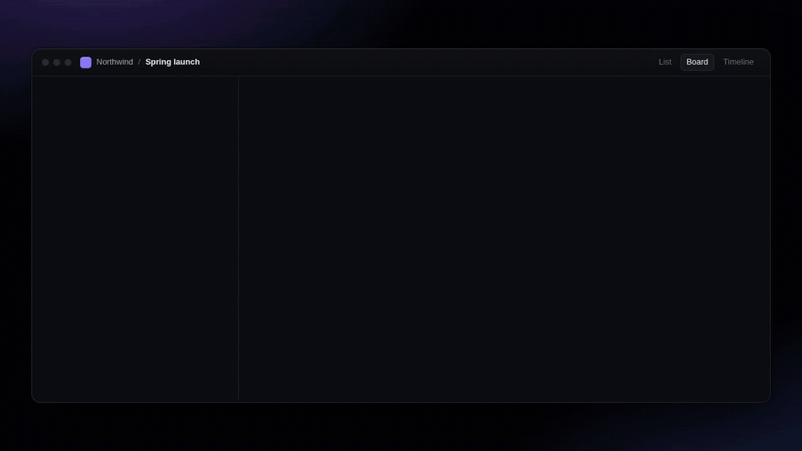

# effect-ui-dnd

Drag and drop for [Effect UI](https://github.com/Effect-TS/ui), by mouse, touch and keyboard: drop zones and sortable lists, with screen reader announcements. Effect v4, headless, no other dependencies.



The [full-quality video](docs/demo.mp4) is in `docs/`. The page is `example/`: `pnpm example` serves it.

Status: early. Effect UI itself is a public preview and not on npm yet, so this package follows its snapshots.

## Install

```sh
pnpm add effect https://pkg.pr.new/Effect-TS/ui/@effect/ui@87a704b
pnpm add github:Butch78/effect-ui-dnd
```

## Use

`DragArea` is a headless component: you draw the markup, it adds the behaviour. Items and zones carry string ids, and a finished drop arrives as a `Dropped` event with the item, the zone and the placement (`before`, `after` or `inside`). A zone with an axis is one entry of a sortable list; `reorder` turns a drop on it into the new order.

```ts
import { DragArea, moveBetween, reorder } from "effect-ui-dnd";

DragArea(h, {
  props: { labels: { write: "Write the brief", bin: "the bin" } },
  onEmit: (event) =>
    event._tag === "Dropped"
      ? Message.DroppedTask({ item: event.item, zone: event.zone, placement: event.placement })
      : Message.PutBackTask(),
  view: (dragArea) =>
    dragArea
      .root(h.main)
      .children(
        h.ul.children(
          model.order.map((id) =>
            dragArea.zone(dragArea.item(h.li.key(id), id), id, "vertical").children(titleOf(id)),
          ),
        ),
        dragArea.zone(h.section, "bin").children("Bin"),
        dragArea.via === "pointer" && dragArea.dragging !== null
          ? dragArea.preview(h.div).children(titleOf(dragArea.dragging))
          : h.span,
        dragArea.announcer(h.div),
        dragArea.instructions(h.div),
      ),
});

// In update, for one list:
DroppedTask: ($, drop) => $.evolve({ order: (order) => reorder(order, drop) });

// Or for a board, where items move between lists such as columns:
DroppedCard: ($, drop) => $.evolve({ columns: (columns) => moveBetween(columns, drop) })
```

`example/main.ts` is a complete page: `pnpm example`.

### Boards

Put sortable zones inside plain zones: a column is `zone(h.section, "todo")`, each card in it `zone(item(h.article, id), id, "vertical")`. A drop anywhere in a column lands before or after its nearest card, and a column with no cards takes it inside. `moveBetween(lists, drop)` turns that into the new lists. `example/board.ts` is a three-column board.

## Parts

| Part           | Use                                                                                     |
| -------------- | --------------------------------------------------------------------------------------- |
| `root`         | holds every item and zone; listens for presses and keys                                 |
| `item`         | a draggable element, by id: `item(h.li, id, { handle?, disabled? })`                    |
| `handle`       | with `{ handle: true }`, the only place the item drags from; it takes focus and keys    |
| `zone`         | a drop target, by id; `zone(h.li, id, "vertical")` makes it one entry of a sorted list  |
| `preview`      | the floating copy under the pointer, sized like the item                                |
| `announcer`    | a visually hidden live region that says what is happening                               |
| `instructions` | visually hidden keyboard instructions the items point to                                |

The parts also return `dragging` (the item id or `null`), `over` (the target under it) and `via` (`"pointer"` or `"keyboard"`).

Style with data attributes: `data-dragging` on the root and the dragged item, `data-over` and `data-placement` on the zone under the drag, `data-dnd-disabled` on a disabled item.

## Props

| Prop         | Default     | Meaning                                                                                                                   |
| ------------ | ----------- | ------------------------------------------------------------------------------------------------------------------------- |
| `distance`   | `8`         | pixels a mouse or pen moves before a press becomes a drag                                                                 |
| `pressDelay` | `0`         | milliseconds a finger holds still before a touch drags; a swipe still scrolls                                             |
| `collision`  | `"pointer"` | `"pointer"`: the zone under the pointer, or none. `"closest"`: else the nearest zone, so gaps between rows still drop     |
| `follow`     | `"preview"` | `"preview"`: you draw `preview`. `"item"`: the item itself moves with the pointer (it stays clipped by its scrolling pane) |
| `autoScroll` | `true`      | scroll the panes around the drag, and the page, while the pointer holds near their edges                                  |
| `labels`     | none        | spoken names of items and zones, by id                                                                                    |
| `phrases`    | English     | what the screen reader hears; `{item}` and `{zone}` take the spoken names                                                 |
| `disabled`   | `false`     | no drags; a drag under way is put back                                                                                    |

Zones scrolled out of view inside a pane do not take drops. While a press is held, the browser's own drag of selected text or images is blocked, and the selection is cleared when the drag starts.

## Keyboard

Space or Enter on a focused item picks it up. The arrow keys step through the zones in document order (in a sortable list, one place at a time). Space or Enter drops; Escape or Tab puts it back.

## Develop

```sh
pnpm install
pnpm check      # effect-tsgo type check with Effect diagnostics, then the tests
pnpm example    # the example page
```

## License

MIT
